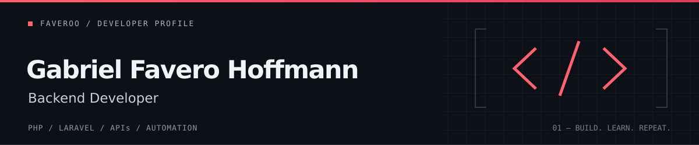
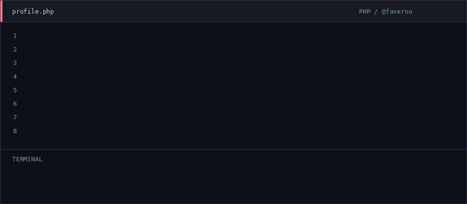
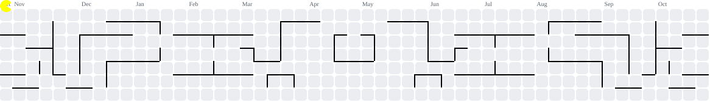
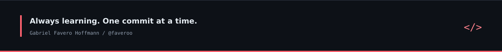

  

  <a href="#about">About</a> &nbsp; / &nbsp;
  <a href="#tech-stack">Tech stack</a> &nbsp; / &nbsp;
  <a href="#github-stats">GitHub stats</a> &nbsp; / &nbsp;
  <a href="#contribution-arcade">Contribution arcade</a>

## About

I'm **Gabriel**, a backend developer focused on **PHP and Laravel**, studying **Systems Analysis and Development** in Brazil.

I enjoy turning business rules into web applications, designing APIs and automating repetitive work. My interests include relational data modeling, application architecture and code that is straightforward to read, test and maintain.

- **Main stack:** PHP, Laravel and MySQL.
- **On the frontend:** React, TypeScript and Inertia.js.
- **Exploring:** Gleam, Go and Python.

  

## Tech stack

**Backend & data**

  
  
  
  

**Frontend**

  
  
  

**Tools & workflow**

  
  
  
  

**Learning & experimenting**

  
  
  

## GitHub stats

  
  

  Updated daily with GitHub Actions. Language usage reflects public repository code, not proficiency.

## Contribution arcade

A year of contributions, one dot at a time.

<picture>
  <source media="(prefers-color-scheme: dark)" srcset="./dist/pacman-contribution-graph-dark.svg" />
  <source media="(prefers-color-scheme: light)" srcset="./dist/pacman-contribution-graph.svg" />
  
</picture>

 

  

  

